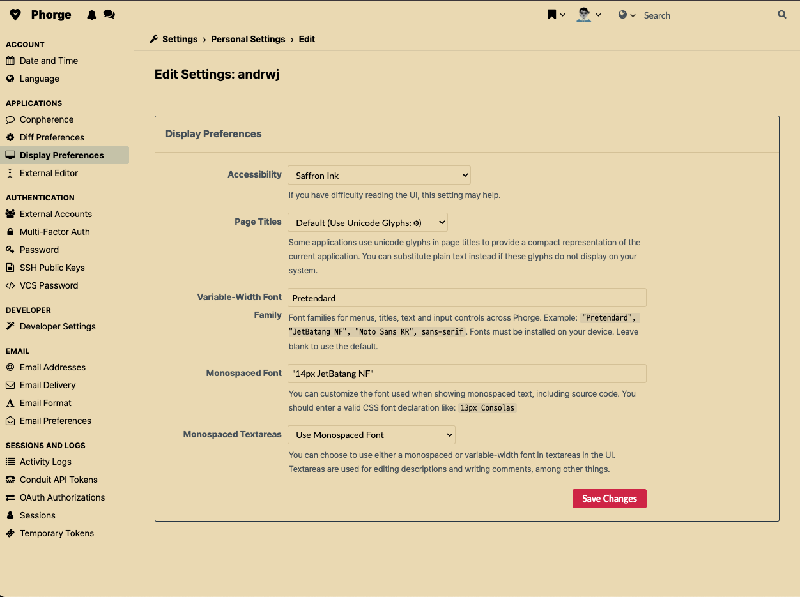

# Customized Phorge 변경사항

`stable`을 기반으로 한 `andrwj` branch에 customized Phabricator의 변경사항을 적용합니다. Phorge에 이미 구현된 기능은 중복 적용하지 않습니다.

## 검색 개선

적용 commit: `5690143e90`

- Global search의 query와 custom indexed content에 NFC normalization을 적용하여 한글 NFC/NFD 입력에 대응합니다.
- Advanced search에서 Title·Content·Comments를 선택할 수 있습니다. 모두 해제하면 검색 결과가 없습니다.
- 일반 검색어는 영문·한글 모두 대소문자를 구분하지 않는 부분검색으로 처리합니다. `Cardputer`로 `CardputerZero`를 찾을 수 있으며, 본문과 댓글에도 동일하게 적용합니다.
- 제외 검색어도 부분검색을 기준으로 처리하고, 명시적인 `=` exact operator는 유지합니다.
- 검색 결과의 Title highlight를 부분검색에 맞춥니다.
- Task 외에 File·Ponder·Wiki 등 custom index가 지원하는 application도 검색 대상으로 포함합니다. Document Types를 선택하면 해당 type으로 제한됩니다.
- 기존 Phorge indexing queue와 viewer 권한 filtering, Ferret fallback을 유지합니다.
- 기존 `search_applicationdocument`·`search_applicationngram` table을 활용하며, document와 ngram을 같은 transaction에서 갱신합니다.

## 추가 UI 및 설정

| 기능 | 동작 | Config option |
| --- | --- | --- |
| Diffusion default branch | Git fallback branch 지정, repository별 override 유지 | `repository.default-git-branch` |
| Home dashboard | built-in Home에 custom dashboard 표시, 없는·archived·권한 없는 dashboard는 기본 Home으로 fallback | `ui.custom.home.default-dashboard` |
| Calendar Day View | 빈 시간대 Drag로 새 event의 Start·End 선택, 기본 5분 | `ui.custom.calendar.drag-select`, `ui.custom.calendar.drag-step-minutes` |
| Workboard | Ctrl + mouse drag scrolling | `ui.custom.workboard.control-pan` |
| Advanced search UI | filter 접기·펼치기, 기본 collapsed | `ui.custom.search.collapsible-filters` |
| Interface font | 사용자별 font family, 기존 Monospaced Font 유지 | `ui.custom.fonts.enabled`, `ui.custom.fonts.ui-family` |
| Paste·Files text size | document font size와 Windows offset 지정 | `ui.custom.document-font-size.enabled`, `ui.custom.paste.font-size`, `ui.custom.files.font-size`, `ui.custom.document-font-size.windows-offset` |
| Paste embed | 모든 application에서 embed height 제한 해제 | `ui.custom.paste.expand-embeds` |
| Config Settings 검색 | Global search와 Settings에서 option metadata 부분검색·NFC/NFD 검색, admin 전용 | `ui.custom.search.config-settings` |

Config Settings 검색에는 실제 설정값·default·example 값을 포함하지 않습니다. Home dashboard option의 `0`은 기본 Home이며, 기존 menu의 explicit default 선택을 우선합니다.

설정은 application directory에서 `./bin/config get <key>`와 `./bin/config set <key> <value>`로 확인·변경합니다.

## Saffron Ink

적용 commit: `fdd1d4d7c8`

**Settings → Display Preferences → Accessibility → Saffron Ink**에서 선택합니다. 기존 Accessibility 항목은 유지하며, font size는 기존 **Use Larger Font Size** 구현을 재사용합니다.

- 배경 `#eddfb7`, 입력 Cursor `#d73a49`, selection `#ffd400` 및 code syntax 색상 적용
- Panel box border와 brand 요소는 `rgb(44, 62, 80)`, wordmark는 black·`font-weight: 900`
- Main menu에 테마 배경색을 적용하고, 투명 배경의 흰색 logo는 CSS `brightness(0)`으로 black 표시
- `ui.custom.theme.saffron-ink`로 선택 항목 노출 제어
- 원본 palette·font size: [CeleritySaffronInkPostprocessor.php](src/applications/celerity/postprocessor/CeleritySaffronInkPostprocessor.php)
- 세부 UI 색상: [saffron-ink.css](webroot/rsrc/css/core/saffron-ink.css)
- 원본 테마의 [MIT license](resources/saffron-ink/LICENSE) 보존

